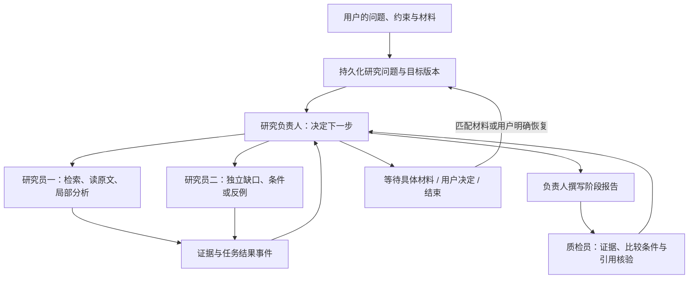

# FastAPI 服务说明

React 页面构建完成后，FastAPI 会在 `http://localhost:7860/` 提供工作台；交互式 API
文档位于 `http://localhost:7860/docs`。不再保留第二套 Gradio 页面。

## 统一运行任务模型

对话、深度研究和每日论文检索都采用同一个可持久化的运行任务模型，并由独立的
`api-worker` 进程执行：

```text
API 请求 -> SQLite 运行记录（queued）-> Redis 优先级队列 -> api-worker
                                                        |-> Redis SSE 事件
```

- 普通队列项仅在 worker 执行期间保存请求文本；每日任务只传递 `run_id`，检索计划已持久化。
- SSE 事件固定为 `status`、`token`、`tool`、`done`、`error`，保留 24 小时。
  进度事件只包含脱敏的阶段名与状态；工具事件只包含工具标识和生命周期状态。
- SQLite 会持久化低频审计事件 `status`、`tool`、`done`、`error`，以及模型、运行器、
  工具集和研究范围组成的执行指纹；`token` 只保留在 Redis，避免把完整回答流复制进数据库。
  审计事件只包含固定阶段说明、聚合耗时/计数和错误类型，不包含提示词、回答、关键词、
  论文内容、工具参数或工具原始结果。因此 Redis 事件过期后，
  `GET /api/v1/runs/{run_id}` 仍可查看任务结果与安全时间线。
- 取消操作会写入 Redis 取消标记；worker 监测到标记后，将现有的协作式取消令牌传给 Agent。
- 对话与深度研究运行中可追加一条文本补充。补充会持久化到 SQLite，并只在下一个模型或研究
  节点被消费；它不会中断已经发出的模型请求，也不会写入普通会话历史或 SSE 事件内容。
- Redis Consumer Group 会保留 worker 异常退出时未确认的任务；重启后的 worker 会在空闲时间达到默认两分钟阈值后认领。活跃执行和已预取的等待任务独立续租，不因处理时间长而被重复认领。
- `GET /api/v1/metrics` 输出 Prometheus 文本指标：Redis 队列积压、worker 心跳、
  各类运行任务的状态计数和 API 进程运行时长。它不输出用户输入、模型回答、论文信息或工具参数。

当前 Compose 只运行一个 `api-worker` 进程，使用有界线程池并发执行。默认普通对话
`CHAT_RUN_CONCURRENCY=2`、深度研究 `RESEARCH_RUN_CONCURRENCY=2`（范围 1–8）；每日检索保持 1。所有任务共享同一个模型客户端及其信号量，增加任务并发不会绕过模型请求上限。

聊天与旧版一次性深度研究按 `session_id` 串行。
新建持续研究使用独立任务上下文，按 `job_id` 排除重复执行；负责人结束一次决策后释放执行名额，
两个独立研究任务可并行，聊天不必等待整项研究结束。研究状态仍通过 SQLite 短事务串行提交。
SQLite 中尚未结束的最早任务决定会话顺序，避免重启后新消息越过尚未认领的旧消息。
每类最多预取“执行名额 + 32”项，等待会话的任务不占执行线程；超出窗口的任务保留在 Redis。
因此极端积压时仍可能出现队首阻塞，当前不承诺所有等待会话都能立即取得名额。
SSE 的 `session_wait` 与 `capacity_wait` 阶段分别表示等待本会话上一轮和等待任务执行名额。

worker 独立更新心跳和 Redis PEL 空闲计时，续租和确认都原子检查消费者身份。
未成功处理并保存结果的异常不再在 `finally` 中无条件确认；已保存终态的任务重投时直接确认，
不再次调用 Agent。进程退出先停止接单，继续给正在执行的任务续租并等待结束；未执行的预取项
留待重启认领。Compose 的停止宽限期耗尽时仍可能被强制终止。

数据目录内的 `api-worker.lock` 使用操作系统锁保护整个 worker 生命周期，不随租约超时失效，
进程退出后自动释放。不能删除锁文件来强制启动第二个 worker，也不要把多个不同数据目录的
worker 指向同一组 Redis 队列。该限制避免旧进程尚在写工具文件时新进程并行重放。
这是单进程并发方案，不是分布式执行权隔离；任务崩溃重放仍不能保证所有外部工具副作用恰好一次。
多进程扩容需要跨进程状态存储、模型信号量和工具写入的幂等/执行权校验。

并发回归使用独立 Redis，不挂载应用数据：

```powershell
docker compose -p research-agent-concurrency-test -f tests/redis.compose.yml up -d
$env:E2E_REDIS_URL = "redis://127.0.0.1:16389/0"
python -m unittest tests.test_run_dispatcher tests.test_mounted_api_e2e -v
docker compose -p research-agent-concurrency-test -f tests/redis.compose.yml down
```

测试包含跨会话重叠、同会话顺序、跨类型互斥、并发上限、排队取消、长任务续租、重复投递、
死消费者认领和结果保存后发布失败。真实 Agent 图的并发持久化测试只模拟模型响应。

Compose 把 Redis 的 AOF/RDB 持久化目录挂载到 `runtime/derived/redis/`。这里包含活动队列与消费组状态，不能当作可重建缓存清理。`scripts/backup_runtime.py`（包括 `--include-derived`）不备份 Redis；维护时应先停止接单与定时投递、排空任务，再正常停止应用、worker 和 Redis，分别保存同一停机时间点的 primary 与整个 Redis 持久化目录。恢复时先加载匹配的 Redis 数据，再启动任务处理，避免旧队列与新 SQLite 混用。完整步骤见 [README 的运行时数据目录](../README.md#运行时数据目录)。

## 鉴权与网络边界

除 `GET /api/v1/health` 外，所有 `/api/v1/*` 路由均接受下列任一种鉴权方式：

```http
X-API-Key: <API_AUTH_TOKEN>
```

或：

```http
Authorization: Bearer <API_AUTH_TOKEN>
```

对外部署前，请在未纳入 Git 的 `.env` 文件中设置：

```env
API_AUTH_TOKEN=use-a-long-random-secret
API_AUTH_REQUIRED=1
```

如果配置了令牌，系统会强制鉴权；若 `API_AUTH_REQUIRED=1` 但缺少令牌，启动会立即失败。
Compose 默认将 7860 端口绑定到 `127.0.0.1`。公开访问时，请在 TLS 反向代理后部署，
并保持 API 鉴权开启。

## 接口列表

| 方法 | 路径 | 说明 |
|---|---|---|
| `GET` | `/api/v1/health` | 无需鉴权的健康检查 |
| `GET` | `/api/v1/metrics` | Prometheus 聚合运行指标，需鉴权 |
| `GET`、`POST` | `/api/v1/sessions` | 列出或创建会话 |
| `DELETE` | `/api/v1/sessions/{session_id}` | 取消会话中的活跃任务并删除会话 |
| `GET` | `/api/v1/sessions/{session_id}/messages` | 恢复该会话的用户可见对话 |
| `GET` | `/api/v1/sessions/{session_id}/usage` | 读取该会话持久化的输入、输出与合计 Token 统计 |
| `GET` | `/api/v1/sessions/{session_id}/runs` | 列出该会话最近的聊天与深度研究任务 |
| `GET` | `/api/v1/workspace/profile` | 读取独立于会话历史的用户画像 |
| `GET` | `/api/v1/workspace/papers` | 列出本地已索引论文与片段数 |
| `GET` | `/api/v1/workspace/paper-relations` | 查看用户确认的论文关系；可用 `paper_id` 过滤 |
| `POST` | `/api/v1/workspace/uploads` | 上传 PDF 或图片，返回仅当前服务可用的脱敏上传 ID |
| `GET`、`POST` | `/api/v1/workspace/daily-keywords` | 列出或添加每日检索关键词 |
| `DELETE` | `/api/v1/workspace/daily-keywords/{keyword}` | 删除一个每日检索关键词 |
| `GET` | `/api/v1/workspace/daily-digest` | 读取当天论文与本地阅读状态 |
| `PUT` | `/api/v1/workspace/daily-papers/status` | 更新当天论文为想读、已读或跳过 |
| `GET` | `/api/v1/workspace/daily-runs` | 列出最近每日检索运行 |
| `GET` | `/api/v1/workspace/daily-runs/{run_id}` | 读取某次检索的摘要、质量提示与论文推荐，用于报告标签页 |
| `GET` | `/api/v1/workspace/badcases` | 列出内容安全的本地 Badcase 候选 |
| `GET`、`PUT` | `/api/v1/workspace/settings` | 读取或保存运行时设置（重启后生效） |
| `POST` | `/api/v1/chat` | 兼容用聊天入口：创建一个聊天任务 |
| `POST` | `/api/v1/runs` | 创建 `chat`、`research` 或 `daily` 任务 |
| `GET` | `/api/v1/runs/{run_id}` | 查看状态、安全指标与最终结果 |
| `GET` | `/api/v1/runs/{run_id}/events` | 读取 SSE 事件流 |
| `POST` | `/api/v1/runs/{run_id}/steers` | 向排队中或运行中的对话/深度研究追加文本补充 |
| `POST` | `/api/v1/runs/{run_id}/cancel` | 请求跨进程协作式取消 |
| `POST` | `/api/v1/runs/{run_id}/badcases` | 标记为本地 Badcase 审核候选 |

`POST /api/v1/sessions/{session_id}/chat-runs` 保留为兼容别名，客户端应逐步迁移到
统一的 `/api/v1/runs` 接口。

## 论文关系增强检索

`runtime/primary/paper_relations.json` 只保存用户明确确认的论文关系，并要求每条关系有两端已索引论文、
简短说明和至少一个页码或检索片段锚点。HTTP 仅提供读取接口；新增、更新和删除由 Agent 工具执行，写入前
必须向用户展示候选关系并获得确认。关系是检索提示而不是论文事实：本地 RAG 先做语义 + BM25 RRF，随后才从
第一轮相关论文的一跳关系中扩展仍匹配当前问题的候选，并施加有限加分；没有主题匹配的关联论文不会被注入结果。
它不使用图数据库、持久化向量图或 GraphRAG；删除论文时会一并移除相关关系。

每日任务的 `daily_kind` 支持 `daily`、`retry`、`search`、`resume`：其中 `resume`
会使用原 `run_id` 重新排队最近一次可恢复的每日任务。

深度研究可在请求体中传入 `scope`（`both`、`local` 或 `public`）限定来源范围。传入
`{"kind":"research","session_id":"…","resume":true}` 会显式恢复当前会话最近一项持续研究，
沿用其研究 ID、证据与剩余总预算。完成后不会自动监控；再次恢复是用户发起的新一次推进。
旧版一次性运行仍由兼容执行器恢复，完成的旧运行直接返回已有结果。

运行中补充使用 `POST /api/v1/runs/{run_id}/steers`，请求体为
`{"message":"…"}`。聊天接受 `queued` / `running`，持续研究还接受 `waiting` / `needs_input`。
返回的运行详情会在 `steers` 中标明该补充是 `pending` 还是已在何处 `consumed`。SSE 仍只发送
`status`、`token`、`tool`、`done`、`error`：补充的文本不会出现在 SSE 或持久化事件日志中。
聊天的“暂停任务”仍是协作式停止。持续研究工作台提供独立的暂停、停止与恢复；控制状态写入
SQLite，暂停后修改目标不会自动恢复，迟到结果也不会唤醒已暂停或停止的研究。

## 持续研究：四个逻辑 Agent

新建 HTTP 深度研究默认采用 `research_projects.py` / `autonomous_research.py` 的持续研究流程：



`report` 是负责人的撰写动作，不是第五个 Agent。Redis、调度器和存储也不是 Agent。
每个研究员一次任务最多四轮工具操作；任务由负责人根据证据缺口、预期判别依据及与既有工作的
区别生成，最多同时派发两项。依赖未完成的任务不会派发。质检只提交问题，补研究仍由负责人决定。
研究员允许给出有依据的局部推断，完整研究的完成由负责人结合质检判断。

默认每项研究共享 48 次模型请求、400,000 Token 上限，包含负责人、研究员、质检和恢复重试；
为报告、质检及最终决策预留 3 次调用和 96,000 Token。调用前按输入 UTF-8 字节数与输出上限
保守预留，收到服务端 usage 后结算；未收到 usage 的请求继续保守计费。预算不是货币报价。
隐藏 HTTP 重试关闭，进程恢复最多重放同一任务两次，已有预留不清零。没有新证据的研究任务
连续累计四次后转入报告，不以调用次数或模型一致意见作为科学进展。

持续研究的非流式请求采用 90 秒读取超时、120 秒总期限，普通聊天仍沿用原配置。
负责人和质检的输出上限为 8,192 Token，研究员首次为 4,096，恢复尝试为 8,192。
报告的上限单独设为 16,384 Token（包含思考 Token），读取超时 120 秒、总期限 150 秒；
正文要求约 1,800 汉字，输出预留仍计入项目总预算。
超时、空正文、截断和可恢复的上游错误最多自动恢复一次，与进程重放共用同一任务的两次
尝试额度；401 等不可恢复错误不重试。调用消耗、未知 usage 预留及目标版本均不重置。
响应结束原因和 usage 保存在尝试记录中，不存储模型思考正文。未知 usage 保持为空，
不会冒充实际计费量。研究员后续失败仍提交已完成工具轮次的证据；截断报告单独保留为
未完成草稿，不能作为已质检报告。失败任务显示“执行失败”，占位说明显示“未完成交付”。

研究、任务、执行尝试、事件、调用预留、报告快照分别保存在同一个 SQLite 数据库中。
结果携带目标版本；旧目标结果保留在任务/尝试记录中，不覆盖当前判断。原始证据不再按每轮
12 条裁掉，提示词独立选取有界子集。证据具有稳定 ID、来源内容指纹及原文定位，`E#` 在研究内
只追加；报告快照冻结目标、证据映射、判断和质检结果。旧版本判断与报告在 UI 中明确标记。

SQLite 待投递任务是持久化 outbox，worker 每 5 秒补投；Redis 使用既有租约与认领机制。
重复投递不会重复提交已完成任务。系统不承诺外部副作用 exactly-once；自动工具限于检索、PDF
读取和本地索引，未自动开放全部 MCP 写工具或实验执行。失败后不将服务故障当成科学反例。
等待 `paper:论文ID` 时检查索引可用性，匹配材料才唤醒负责人，不让模型定时空转。

研究独立于聊天存续：删除聊天保留研究，可在输入框选择“多 Agent 研究”后，在对话区全局选择和恢复。以下接口遵循相同鉴权：

| 方法 | 路径 | 用途 |
| --- | --- | --- |
| GET | `/api/v1/research-projects` | 全局研究列表，包含已删除聊天发起的研究 |
| GET | `/api/v1/research-projects/{id}` | 判断、证据、预算、任务、历史报告目录 |
| POST | `/api/v1/research-projects/{id}/controls` | `pause` / `stop` / `resume` / `steer` / `material` |
| GET | `/api/v1/research-projects/{id}/reports/{report_id}` | 冻结的报告与证据快照 |

控制请求为 `{"action":"steer","message":"只比较同样负载","event_id":"客户端幂等键"}`；
材料事件的 message 必须匹配等待标识。只更新材料不复活暂停、停止或已完成研究。
运行状态与结论可信度分开显示，预算结束、无可行路径或核验失败不会伪装为“问题已解决”。
`ResearchAgent.research()` 的直接 CLI 调用及既有运行保留原一次性执行器；本次持续执行入口为
HTTP 工作台与 Redis worker。离线与受控模型测试验证控制机制，不代表已证明真实研究质量或
多 Agent 相对同预算单 Agent 的效果优势。

代码复现接口与队列消费者已移除。`POST /api/v1/runs` 不再接受 `kind="experiment"`（返回 422），旧 `/api/v1/workspace/experiments` 接口返回 404。已有实验文件与历史数据库表保留，不参与会话调度或任务统计；旧 Redis 复现队列不会被新 worker 消费。升级时应先结束旧 worker，再更新 API 与 worker，避免旧版本继续执行任务。

### 持久运行事件

`GET /api/v1/runs/{run_id}` 返回的 `events` 是低频审计时间线。每条事件包含数据库
排序 id、`event_type`、`stage`、`status`、聚合 `metrics` 和可选 `metadata`。其中
`metadata` 只允许 `protocol`、`run_kind`、`model`、`runner`、`scope`、`toolset`，可用于
比较执行环境；其他字段会在写入前丢弃。客户端若需要逐 token 展示，仍应连接 SSE，不能
依赖该数组复原模型输出。

### Badcase 候选

`POST /api/v1/runs/{run_id}/badcases` 接受受限的 `category` 和至多 500 字的人工脱敏备注。它从既有运行记录投影出内容安全的快照：运行类型、状态、模型标识、耗时、聚合指标和安全事件字段；不会存储或返回 prompt、回答、PDF、论文候选、工具参数或工具原始结果。响应只含候选 ID、分类、来源、状态、去重指纹和出现次数，候选实际保存在本地 `badcases.db`。

相同 `run_id + category` 重复提交不会创建新候选，而是增加 `occurrence_count`。删除所属会话时会同时删除其候选；如需把问题沉淀为 Git 内的回归测试，应使用导出脚本生成空的合成夹具草稿，再人工填写公开、可复现的数据。

## 调用示例

```bash
TOKEN='your-long-random-secret'

# 创建会话
curl -X POST http://localhost:7860/api/v1/sessions \
  -H "X-API-Key: $TOKEN" \
  -H 'Content-Type: application/json' \
  -d '{"title":"API 会话"}'

# 创建聊天任务
curl -X POST http://localhost:7860/api/v1/runs \
  -H "Authorization: Bearer $TOKEN" \
  -H 'Content-Type: application/json' \
  -d '{"kind":"chat","session_id":"<session_id>","message":"解释 RAG 冷启动时的降级策略。"}'

# 创建深度研究任务
curl -X POST http://localhost:7860/api/v1/runs \
  -H "Authorization: Bearer $TOKEN" \
  -H 'Content-Type: application/json' \
  -d '{"kind":"research","session_id":"<session_id>","query":"比较 RAG 检索重排序方法。"}'

# 创建一次临时每日检索任务
curl -X POST http://localhost:7860/api/v1/runs \
  -H "Authorization: Bearer $TOKEN" \
  -H 'Content-Type: application/json' \
  -d '{"kind":"daily","daily_kind":"search","keyword":"检索增强生成"}'

# 持续读取运行事件
curl -N -H "X-API-Key: $TOKEN" \
  http://localhost:7860/api/v1/runs/<run_id>/events

# 在任务运行期间补充约束或新线索（下一节点才会使用）
curl -X POST http://localhost:7860/api/v1/runs/<run_id>/steers \
  -H "X-API-Key: $TOKEN" \
  -H 'Content-Type: application/json' \
  -d '{"message":"补充：未经核验的内容请明确标为待确认。"}'

# 标记一个已完成或失败的任务；备注必须由调用方自行脱敏
curl -X POST http://localhost:7860/api/v1/runs/<run_id>/badcases \
  -H "X-API-Key: $TOKEN" \
  -H 'Content-Type: application/json' \
  -d '{"category":"citation_quality","note":"已脱敏：引用未覆盖结论"}'

# 抓取脱敏的运行指标
curl -H "X-API-Key: $TOKEN" http://localhost:7860/api/v1/metrics
```

## 模型错误诊断

普通对话的模型失败会在安全审计事件中持久化 `error_details`；失败运行的
`GET /api/v1/runs/{run_id}` 从已存事件恢复顶层诊断。SSE 的 `error`、`done` 和已知
`status` 事件可携带同一白名单结构，刷新后可从历史运行重新加载详情。

- `code`、`phase`、`exception_type`、`cause_type`：固定错误类别、阶段及异常类别。
- `http_status`：共享请求预算内最后一次实际收到的 HTTP 状态；从未收到响应时省略。
  它可能是 `200`，而后续流式读取仍失败，不能把它当成失败原因或伪造为 `504`。
- `elapsed_ms`、`deadline_ms`、`queue_wait_ms`：实测耗时、总预算和排队耗时。
- `attempts`、`retries_used`：实际发出的请求及重试次数；预留重试但预算耗尽时不算已重试。
- `request_id`：存在且通过校验的 `request-id`／`x-request-id` 响应头，用于上游关联。

诊断字段不包含请求正文、提示词、响应原文、URL、API Key 或 Authorization。
旧运行没有这些信息时返回空诊断，不通过错误文案猜测 HTTP 状态。
普通对话的请求总预算默认 180 秒（`api_resilience.request_deadline_seconds`），
读取停滞超时仍为 30 秒；排队、请求和恢复共用总预算，最多自动重试两次。
断流后只重发当前模型请求，保留已完成的工具结果；恢复期间保留可见草稿，
完成后用 SSE `done.answer` 替换草稿，历史记录保存完整答案，避免重复文字或重复执行工具。
`finish_reason=length` 会触发受同一预算约束的精简重生成；内容过滤不自动重试。
流格式错误、空答案和不完整工具参数不能当作成功。恢复失败后保留部分正文并标记失败，
不再执行残缺工具调用或对残缺答案进行事实核验。用户取消会停止恢复并释放并发槽。
运行事件中的 `recovering` 状态保留脱敏的中断原因；恢复成功后运行状态为 `completed`。
结构化持久化目前接入普通对话链路；其他运行类型保留兼容接口，不代表已接入每个编排节点。
